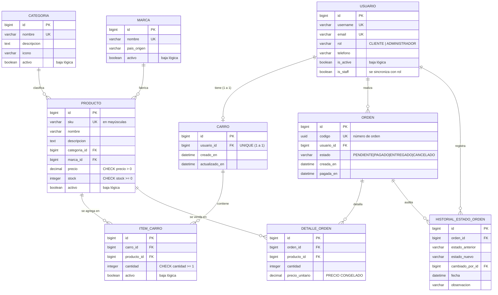

# HardPoint PC — E-commerce de componentes informáticos

API REST y panel de gestión para una tienda de hardware, con carro de compras
persistente en PostgreSQL, autenticación JWT con roles y control de stock
verificado de forma atómica al momento del pago.

| | |
|---|---|
| **Alumna** | Genesis Quezada Sanzana |
| **Sección** | IEC-C4-N2 |
| **Año** | 2026 |
| **Asignatura** | Desarrollo Backend — Evaluación EVA-2 |
| **Proyecto Django** | `tienda_hardware` |
| **Repositorio** | `tienda-hardware-pc` |

---

## Tabla de contenidos

1. [Qué hace el sistema](#1-qué-hace-el-sistema)
2. [Stack tecnológico](#2-stack-tecnológico)
3. [Modelo de datos](#3-modelo-de-datos)
4. [Instalación paso a paso (PowerShell)](#4-instalación-paso-a-paso-powershell)
5. [Credenciales de prueba](#5-credenciales-de-prueba)
6. [Tabla de endpoints y permisos](#6-tabla-de-endpoints-y-permisos)
7. [Guía para probar en Swagger](#7-guía-para-probar-en-swagger)
8. [Pantallas HTML](#8-pantallas-html)
9. [Cómo se controla el stock](#9-cómo-se-controla-el-stock)
10. [Pruebas automatizadas](#10-pruebas-automatizadas)
11. [Estructura del proyecto](#11-estructura-del-proyecto)
12. [Notas de instalación en Windows](#12-notas-de-instalación-en-windows)
13. [Subir el repositorio a GitHub](#13-subir-el-repositorio-a-github)
14. [Uso de IA en el desarrollo](#14-uso-de-ia-en-el-desarrollo)

---

## 1. Qué hace el sistema

**HardPoint PC** es un e-commerce especializado en componentes informáticos
(procesadores, tarjetas de video, memorias RAM, placas madre, almacenamiento y
fuentes de poder). Existen dos roles:

- **Cliente**: explora el catálogo, ve el detalle de cada componente y mantiene un
  carro de compras persistente donde agrega productos, cambia cantidades o quita
  ítems. Al hacer el checkout se genera una Orden de Compra que **congela los
  precios** de ese instante.
- **Administrador de TI**: gestiona categorías, marcas y productos, y controla el
  ciclo de vida de las órdenes (pagar, entregar o cancelar).

La pieza delicada del negocio es el **control de stock**:

- Agregar al carro **no** descuenta stock.
- El checkout **no** descuenta stock (solo congela los precios).
- El **pago** verifica el stock con las filas bloqueadas en la base de datos y lo
  descuenta. Si no alcanza, se revierte todo y la API responde **409 Conflict**
  indicando qué producto faltó.
- **Cancelar** una orden pagada **repone** el stock automáticamente.

Nada de negocio se borra físicamente: «eliminar» significa `activo = False`
(`is_active = False` en los usuarios), y todo registro dado de baja se puede
reactivar.

---

## 2. Stack tecnológico

| Componente | Versión | Para qué |
|---|---|---|
| Python | 3.12.10 | Lenguaje |
| Django | 5.2.17 (LTS) | Framework web |
| Django REST Framework | 3.18.1 | API REST |
| djangorestframework-simplejwt | 5.5.1 | Autenticación JWT con lista negra |
| django-filter | 26.1 | Filtros de consulta |
| drf-spectacular | 0.30.0 | OpenAPI 3 + Swagger UI + ReDoc |
| psycopg | 3.3.6 | Driver de PostgreSQL |
| python-decouple | 3.8 | Configuración desde `.env` |
| PostgreSQL | 16 / 18 | Base de datos |
| Bootstrap | 5.3.3 (CDN) | Diseño de las pantallas |
| Bootstrap Icons | 1.11.3 (CDN) | Iconografía |

Configuración regional: `LANGUAGE_CODE = "es-cl"`,
`TIME_ZONE = "America/Santiago"`, `USE_TZ = True`,
`DEFAULT_AUTO_FIELD = "django.db.models.BigAutoField"`,
`AUTH_USER_MODEL = "usuarios.Usuario"`.

El frontend usa plantillas Django con herencia (`base.html` + ``) y
JavaScript nativo. No se usa jQuery en las pantallas propias.

---

## 3. Modelo de datos

La base está en **3.ª forma normal**:

- **1FN** — todos los campos son atómicos.
- **2FN** — cada tabla tiene clave primaria simple y todos sus campos dependen por
  completo de ella.
- **3FN** — `Producto` no repite el nombre de su categoría ni de su marca (guarda
  solo las claves foráneas), y no se almacena ningún dato calculable: los
  subtotales y los totales se calculan al leerlos.

La única excepción aparente es `DetalleOrden.precio_unitario`, y no es una
excepción real: ese valor es un **hecho histórico** —el precio que el cliente
aceptó ese día— y por eso debe quedar guardado.



### Restricciones que impone PostgreSQL

| Restricción | Tabla | Qué garantiza |
|---|---|---|
| `producto_sku_unico` | producto | No hay dos productos con el mismo SKU |
| `producto_precio_positivo` | producto | El precio nunca es cero ni negativo |
| `producto_stock_no_negativo` | producto | El stock nunca queda negativo |
| `categoria_nombre_unico` | categoría | No hay categorías repetidas |
| `marca_nombre_unico` | marca | No hay marcas repetidas |
| `item_unico_por_carro` | ítem de carro | Un producto aparece una sola vez por carro |
| `item_carro_cantidad_minima` | ítem de carro | La cantidad es al menos 1 |
| `detalle_unico_por_orden` | detalle de orden | Un producto aparece una vez por orden |
| `detalle_cantidad_minima` | detalle de orden | La cantidad vendida es al menos 1 |
| `detalle_precio_positivo` | detalle de orden | El precio congelado es mayor que cero |

También hay índices en `categoria`, `marca` y `precio` de `Producto`, y en
`estado` y `usuario` de `Orden`.

---

## 4. Instalación paso a paso (PowerShell)

### 4.1 Requisitos

- Python 3.12 o 3.13
- PostgreSQL 16 o 18 en ejecución
- Git

### 4.2 Clonar y crear el entorno virtual

```powershell
git clone https://github.com/<su-usuario>/tienda-hardware-pc.git
cd tienda-hardware-pc

py -3.12 -m venv .venv
.\.venv\Scripts\Activate.ps1
python -m pip install --upgrade pip
```

> Si PowerShell bloquea la activación del entorno, habilite los guiones firmados
> para su usuario y vuelva a intentarlo:
> ```powershell
> Set-ExecutionPolicy -Scope CurrentUser -ExecutionPolicy RemoteSigned
> ```

### 4.3 Instalar las dependencias

```powershell
pip install -r requirements.txt
```

### 4.4 Configurar el archivo .env

```powershell
Copy-Item .env.example .env
```

Abra `.env` y complete los valores. Como mínimo hay que ajustar `SECRET_KEY`,
`DB_PASSWORD` y `DB_PORT`:

```ini
ALUMNO_NOMBRE=Genesis Quezada Sanzana
ALUMNO_SECCION=IEC-C4-N2
ALUMNO_ANIO=2026
NOMBRE_COMERCIAL=HardPoint PC

SECRET_KEY=coloque-aqui-una-clave-secreta-generada
DEBUG=True
ALLOWED_HOSTS=localhost,127.0.0.1,[::1],testserver

DB_ENGINE=django.db.backends.postgresql
DB_NAME=tienda_hardware_db
DB_USER=postgres
DB_PASSWORD=su-contrasena-de-postgres
DB_HOST=localhost
DB_PORT=5432

PG_BIN_DIR=C:\Program Files\PostgreSQL\16\bin
```

Para generar una clave secreta nueva:

```powershell
python -c "from django.core.management.utils import get_random_secret_key as g; print(g())"
```

> **Importante:** `DB_PORT` debe ser el puerto donde escucha *su* servidor
> PostgreSQL. Si tiene más de una versión instalada, cada una usa un puerto
> distinto (habitualmente 5432 la primera y 5433 la segunda). Para averiguarlo:
> ```powershell
> Get-Content "C:\Program Files\PostgreSQL\16\data\postgresql.conf" | Select-String "^port"
> ```
> En el equipo donde se desarrolló este proyecto, la instancia con la contraseña
> configurada era **PostgreSQL 18 en el puerto 5433**, y por eso el `.env` local
> usa `DB_PORT=5433`.

### 4.5 Crear la base de datos

```powershell
$env:PGPASSWORD = "su-contrasena-de-postgres"
& "C:\Program Files\PostgreSQL\16\bin\psql.exe" -U postgres -h localhost -p 5432 -f crear_bd.sql
```

El guion `crear_bd.sql` crea `tienda_hardware_db` con codificación **UTF8** y
concede el permiso `CREATEDB` al rol, necesario para que `manage.py test` pueda
crear su base de datos de pruebas. Es idempotente: si la base ya existe, no falla.

### 4.6 Aplicar las migraciones

```powershell
python manage.py migrate
```

### 4.7 Cargar los datos de prueba

```powershell
python manage.py seed_data
```

Esto crea 1 administrador, 3 clientes, 6 categorías, 8 marcas, 25 productos
(algunos con stock 1 y otros con stock 0, para poder demostrar las validaciones),
dos carros con ítems y cuatro órdenes de ejemplo, una en cada estado, con su
historial.

Para volver a dejar el escenario exactamente igual en cualquier momento:

```powershell
python manage.py seed_data --reset
```

### 4.8 Levantar el servidor

```powershell
python manage.py runserver
```

| Dirección | Contenido |
|---|---|
| http://127.0.0.1:8000/ | Portada con estadísticas reales |
| http://127.0.0.1:8000/catalogo/ | Catálogo público con filtros |
| http://127.0.0.1:8000/panel/ | Panel de gestión |
| http://127.0.0.1:8000/documentacion/ | Guía del sistema |
| http://127.0.0.1:8000/api/docs/ | Swagger UI (con Authorize JWT) |
| http://127.0.0.1:8000/api/redoc/ | ReDoc |
| http://127.0.0.1:8000/api/schema/ | Esquema OpenAPI 3 |

### 4.9 Ejecutar las pruebas

```powershell
python manage.py test
```

### 4.10 Demostrar el control de concurrencia

```powershell
python manage.py simular_concurrencia
```

---

## 5. Credenciales de prueba

Las crea `python manage.py seed_data`.

| Usuario | Contraseña | Rol | Situación inicial |
|---|---|---|---|
| `admin_ti` | `Admin.2026` | Administrador de TI | Gestiona catálogo y órdenes |
| `cliente1` | `Cliente.2026` | Cliente | Con carro cargado (4 unidades) |
| `cliente2` | `Cliente.2026` | Cliente | Con carro cargado (2 unidades) |
| `cliente3` | `Cliente.2026` | Cliente | Con carro vacío (para probar el error de checkout) |

---

## 6. Tabla de endpoints y permisos

### Matriz de roles exigida por la pauta

| Rol | Endpoints |
|---|---|
| **PÚBLICO** | `GET /api/productos/`, `GET /api/categorias/` |
| **CLIENTE** | `GET/POST/DELETE /api/carro/`, `POST /api/ordenes/checkout/`, `GET /api/mis-ordenes/` |
| **ADMINISTRADOR** | `POST/PUT/DELETE /api/productos/`, `PATCH /api/ordenes/{id}/estado/` |

Sin token la respuesta es **401**; con un token cuyo rol no corresponde, **403**.

### Autenticación

| Método | Ruta | Permiso | Qué hace |
|---|---|---|---|
| GET | `/api/` | Público | Índice de endpoints y datos de la alumna |
| POST | `/api/auth/registro/` | Público | Crea una cuenta, siempre con rol CLIENTE |
| POST | `/api/auth/login/` | Público | Devuelve `access` y `refresh` con el claim `rol` |
| POST | `/api/auth/refresh/` | Público | Renueva el access token (rota el refresh) |
| POST | `/api/auth/logout/` | Autenticado | Envía el refresh a la lista negra |
| GET | `/api/auth/perfil/` | Autenticado | Datos del usuario y claims del token |

### Catálogo

| Método | Ruta | Permiso |
|---|---|---|
| GET | `/api/productos/` | Público (con filtros, búsqueda, orden y paginación) |
| GET | `/api/productos/{id}/` | Público |
| POST | `/api/productos/` | Administrador |
| PUT / PATCH | `/api/productos/{id}/` | Administrador |
| DELETE | `/api/productos/{id}/` | Administrador (baja lógica) |
| POST | `/api/productos/{id}/reactivar/` | Administrador |
| GET | `/api/categorias/`, `/api/categorias/{id}/` | Público |
| POST / PUT / PATCH / DELETE | `/api/categorias/…` | Administrador |
| POST | `/api/categorias/{id}/reactivar/` | Administrador |
| GET | `/api/marcas/`, `/api/marcas/{id}/` | Público |
| POST / PUT / PATCH / DELETE | `/api/marcas/…` | Administrador |
| POST | `/api/marcas/{id}/reactivar/` | Administrador |

**Filtros de `/api/productos/`**: `categoria`, `categoria_nombre`, `marca`,
`marca_nombre`, `precio_min`, `precio_max`, `en_stock`, `sku`, `buscar`,
`search`, `ordering`, `page`, `incluir_inactivos`.

### Carro (solo CLIENTE)

| Método | Ruta | Qué hace |
|---|---|---|
| GET | `/api/carro/` | Ítems, precios vigentes, subtotales y total |
| POST | `/api/carro/` | Agrega un producto (si ya estaba, **suma** la cantidad) |
| DELETE | `/api/carro/` | Vacía el carro (baja lógica de todos los ítems) |
| PATCH | `/api/carro/items/{producto_id}/` | Fija la cantidad exacta |
| DELETE | `/api/carro/items/{producto_id}/` | Quita el ítem (baja lógica) |

### Órdenes

| Método | Ruta | Permiso | Qué hace |
|---|---|---|---|
| POST | `/api/ordenes/checkout/` | Cliente | Crea la orden y **congela los precios** |
| POST | `/api/ordenes/{id}/pagar/` | Cliente dueño | **Descuenta el stock** de forma atómica |
| GET | `/api/mis-ordenes/` | Cliente | Solo sus órdenes |
| GET | `/api/mis-ordenes/{id}/` | Cliente | Detalle, total e historial |
| GET | `/api/ordenes/` | Administrador | Todas las órdenes, con filtros |
| GET | `/api/ordenes/{id}/` | Administrador | Detalle e historial |
| PATCH | `/api/ordenes/{id}/estado/` | Administrador | Cambia el estado según las transiciones |

**Filtros de `/api/ordenes/`**: `estado`, `usuario`, `fecha_desde`,
`fecha_hasta`, `codigo`, `ordering`.

### Usuarios (solo ADMINISTRADOR)

| Método | Ruta | Qué hace |
|---|---|---|
| GET | `/api/usuarios/` | Lista (con `?incluir_inactivos=true` y `?rol=`) |
| POST | `/api/usuarios/` | Crea un usuario eligiendo su rol |
| GET / PUT / PATCH | `/api/usuarios/{id}/` | Consulta y edición |
| DELETE | `/api/usuarios/{id}/` | Baja lógica (`is_active = False`) |
| POST | `/api/usuarios/{id}/reactivar/` | Reactiva la cuenta |
| GET | `/api/usuarios/{id}/carro/` | Carro persistido de ese cliente |

---

## 7. Guía para probar en Swagger

1. Abra **http://127.0.0.1:8000/api/docs/**.
2. Despliegue `POST /api/auth/login/`, pulse **Try it out** y envíe:
   ```json
   { "username": "cliente1", "password": "Cliente.2026" }
   ```
3. Copie el valor del campo `access` de la respuesta.
4. Pulse el botón **Authorize** (arriba a la derecha), pegue el token y confirme.
   El esquema es *Bearer*: Swagger agrega por sí mismo el encabezado
   `Authorization: Bearer <token>`.
5. **Ver el carro**: `GET /api/carro/`. Verá los ítems con su precio vigente, los
   subtotales y el total, todos calculados.
6. **Agregar un producto**: `POST /api/carro/` con
   ```json
   { "producto": 1, "cantidad": 2 }
   ```
   Repita la llamada: comprobará que la cantidad **se suma** al ítem existente y
   que no se crea una segunda línea.
7. **Checkout**: `POST /api/ordenes/checkout/`. La orden queda en `PENDIENTE`, con
   los precios congelados, y la respuesta indica `"stock_descontado": false`.
8. **Pagar**: `POST /api/ordenes/{id}/pagar/` con el id que devolvió el checkout.
   Aquí sí se descuenta el stock y la orden pasa a `PAGADO`.
9. **Cambiar el estado** (requiere el otro rol): vuelva a `POST /api/auth/login/`
   con `admin_ti` / `Admin.2026`, pulse **Authorize** otra vez con el token nuevo
   y use `PATCH /api/ordenes/{id}/estado/` con
   ```json
   { "estado": "ENTREGADO", "observacion": "Retirado en tienda." }
   ```

### Cómo ver el rechazo 409 por falta de stock

1. Como `cliente2`, agregue al carro el producto `GPU-NVD-RTX4090`, que tiene
   stock 1, y haga el checkout.
2. Como `admin_ti`, ponga su stock en 0 con
   `PATCH /api/productos/{id}/` y `{"stock": 0}`.
3. Como `cliente2`, intente pagar: la respuesta es **409 Conflict** con la lista
   de faltantes (pedido frente a disponible), la orden sigue en `PENDIENTE` y el
   stock no cambió.

### Cómo comprobar que el carro persiste

1. Como `cliente1`, mire su carro con `GET /api/carro/`.
2. Cierre sesión con `POST /api/auth/logout/`, enviando el `refresh`.
3. Compruebe que ese `refresh` ya no sirve: `POST /api/auth/refresh/` responde 401.
4. Vuelva a iniciar sesión y consulte `GET /api/carro/`: los ítems, las cantidades
   y el total son exactamente los mismos, porque el carro vive en PostgreSQL y
   está ligado al id del usuario, no a la sesión.

---

## 8. Pantallas HTML

Las pantallas HTML se pueden **ver sin iniciar sesión** (igual que la API deja
leer el catálogo sin token), pero **editar algo** — pagar una orden, operar el
carro de un cliente, o crear/editar/dar de baja un usuario o un producto — exige
una sesión de **Administrador de TI** en `/panel/login/`. Es una sesión de
Django (cookies), independiente del JWT de la API. Ver el detalle y el motivo en
`DEFENSA.md`, sección 9. Las pantallas usan el ORM, `ModelForm` con validación y
mensajes flash, y llaman a las **mismas funciones de servicio** que la API, de
modo que el control de stock y de concurrencia es idéntico por ambos caminos.

| Ruta | Contenido |
|---|---|
| `/` | Portada con estadísticas reales, productos destacados y accesos rápidos |
| `/catalogo/` | Catálogo público con filtros, búsqueda, orden y paginación |
| `/catalogo/<id>/` | Ficha del componente (SKU, marca, categoría, precio, stock) |
| `/panel/` | Panel de gestión con tarjetas hacia cada módulo |
| `/panel/login/` | Inicio de sesión de administrador (exige rol ADMINISTRADOR) |
| `/panel/logout/` | Cierre de sesión (solo POST) |
| `/panel/categorias/` | CRUD de categorías con baja lógica y reactivación |
| `/panel/marcas/` | CRUD de marcas |
| `/panel/productos/` | CRUD de productos |
| `/panel/usuarios/` | CRUD de usuarios, con elección de rol |
| `/panel/carros/` | Selector «Ver carro de: [cliente]» y operación completa del carro |
| `/panel/ordenes/` | Listado con filtros y ficha con historial y botones de transición |
| `/documentacion/` | Guía del sistema con la matriz de roles y el flujo de negocio |

### Ninguna dirección muestra un 404

El proyecto protege las rutas inexistentes con tres capas:

1. **Catch-all** `re_path(r"^.*$")` al final de `tienda_hardware/urls.py`.
2. **handler404** `core.views.pagina_no_encontrada`, que actúa con `DEBUG = False`.
3. **Middleware** `core.middleware.RedireccionNoEncontradaMiddleware`, que atrapa
   los `Http404` lanzados dentro de una vista incluso con `DEBUG = True`.

Cualquier dirección inventada (`/asdf`, `/api/xyz`, `/panel/productos/999999/`,
`/%%%`…) muestra la pantalla de redirección, con la ruta solicitada, una cuenta
regresiva de 3 segundos y un botón «Volver al inicio». Las rutas que existen con
barra final redirigen a ellas: `/catalogo` → `/catalogo/`.

En la API, un recurso inexistente responde JSON controlado en español, con la
clave `"redireccion": "/"`, nunca una página de error HTML.

---

## 9. Cómo se controla el stock

Toda la lógica vive en `ordenes/servicios.py`.

| Operación | Efecto sobre el stock |
|---|---|
| Agregar al carro | **Ninguno** (solo valida que la cantidad no supere lo disponible) |
| Checkout | **Ninguno** (congela los precios en `DetalleOrden.precio_unitario`) |
| Pago | **Descuenta** con `F("stock") - cantidad` |
| `PENDIENTE → CANCELADO` | Ninguno (nunca se descontó) |
| `PAGADO → ENTREGADO` | Ninguno (la venta se cierra) |
| `PAGADO → CANCELADO` | **Repone** con `F("stock") + cantidad` |

### Por qué el stock nunca queda negativo

`pagar_orden()` hace, en este orden:

1. `transaction.atomic()` envuelve toda la operación.
2. `select_for_update()` bloquea la orden y comprueba que siga en `PENDIENTE`, para
   que dos peticiones no la cobren dos veces.
3. Bloquea **todas** las filas de productos implicadas con
   `Producto.objects.select_for_update().filter(id__in=ids).order_by("id")`. El
   orden fijo por id evita interbloqueos entre dos pagos que compartan productos.
4. Con las filas bloqueadas relee el stock real y lo verifica producto por
   producto. Si a alguno no le alcanza, lanza `StockInsuficienteError`: la
   excepción revierte la transacción completa y la orden sigue en `PENDIENTE`.
5. Si todo alcanza, descuenta con `F("stock") - cantidad` —una resta que resuelve
   PostgreSQL, sin leer y escribir el valor desde Python— y marca la orden.

El `CheckConstraint stock >= 0` de la tabla es la última barrera.

### Demostración

```powershell
python manage.py simular_concurrencia
```

El comando crea un producto con stock 1 y dos clientes, cada uno con una orden
`PENDIENTE` por esa única unidad, y lanza dos hilos que pagan al mismo tiempo
(sincronizados con una barrera). La salida muestra que un pago queda `PAGADO`, que
el otro es rechazado por falta de stock y que el stock final es 0, nunca -1. Cada
hilo cierra su propia conexión al terminar.

---

## 10. Pruebas automatizadas

```powershell
python manage.py test
```

**221 pruebas**, repartidas así:

| Módulo | Pruebas | Qué cubre |
|---|---|---|
| `usuarios/tests.py` | 29 | Login JWT, claim `rol` decodificado, matriz de permisos, logout con lista negra, CRUD con baja lógica, sincronización de `is_staff` |
| `catalogo/tests.py` | 40 | Los seis filtros de `django-filter`, búsqueda, orden, paginación, baja lógica por API y por HTML, validaciones y `CheckConstraint` |
| `carro/tests.py` | 38 | Persistencia tras el logout, suma sin duplicar filas, que agregar no descuenta stock, baja lógica de ítems, aislamiento entre clientes |
| `ordenes/tests.py` | 57 | Checkout con precios congelados, pago atómico, 409 por stock insuficiente, reposición al cancelar, transiciones inválidas, **concurrencia real** y aislamiento de órdenes |
| `core/tests.py` | 57 | Que ninguna ruta inexistente dé 404 (14 direcciones), que ninguna pantalla filtre código de plantilla (34 pantallas), archivos estáticos ausentes, redirección con barra final, footer con los datos de la alumna, OpenAPI, filtro `|clp` y configuración |

Para ejecutar un módulo o una prueba concreta:

```powershell
python manage.py test ordenes
python manage.py test ordenes.tests.PruebasConcurrencia
```

La prueba de concurrencia usa `TransactionTestCase`, porque necesita transacciones
reales: `TestCase` envuelve cada prueba en una transacción y los otros hilos no
verían los cambios.

---

## 11. Estructura del proyecto

```
tienda-hardware-pc/
├── manage.py                  Fuerza la salida de consola a UTF-8 (Windows)
├── requirements.txt
├── crear_bd.sql               Crea la base con ENCODING UTF8 y da CREATEDB
├── .env / .env.example
├── .gitignore
├── README.md
├── DEFENSA.md                 Ubicación exacta de cada indicador de la rúbrica
│
├── tienda_hardware/           Paquete de configuración
│   ├── __init__.py            Resuelve la carga de libpq en Windows
│   ├── settings.py            16 bloques comentados
│   ├── urls.py                API, HTML y las tres capas anti-404
│   ├── wsgi.py / asgi.py
│
├── core/                      Transversal
│   ├── views.py               Inicio, panel, documentación, redirección, raíz de la API
│   ├── context_processors.py  Datos de la alumna a todas las plantillas
│   ├── middleware.py          Capa 3 del control de rutas
│   ├── excepciones.py         Errores JSON uniformes en español
│   ├── utilidades.py          obtener_o_redirigir() en lugar de get_object_or_404
│   ├── templatetags/formato.py  Filtro |clp y badges de estado
│   └── management/commands/   seed_data.py y simular_concurrencia.py
│
├── usuarios/                  Usuario, roles y JWT
│   ├── models.py              Usuario (AbstractUser) + Rol (TextChoices)
│   ├── tokens.py              TokenConRolSerializer: agrega el claim rol
│   ├── permisos.py            EsAdministrador, EsCliente, EsAdministradorOSoloLectura, EsPropietarioDeLaOrden
│   ├── signals.py             Crea el carro de cada cliente
│   └── serializers / views / views_html / forms / urls / admin / tests
│
├── catalogo/                  Categoría, Marca, Producto
│   ├── filtros.py             ProductoFilter (compartido por API y HTML)
│   └── models / serializers / views / views_html / forms / urls / admin / tests
│
├── carro/                     Carro persistente
│   ├── servicios.py           agregar_producto, actualizar_cantidad, quitar_producto, vaciar_carro
│   └── models / serializers / views / views_html / forms / urls / admin / tests
│
├── ordenes/                   Orden, DetalleOrden, HistorialEstadoOrden
│   ├── servicios.py           realizar_checkout, pagar_orden, cambiar_estado_orden
│   ├── filtros.py             OrdenFilter
│   └── models / serializers / views / views_html / forms / urls / admin / tests
│
├── templates/
│   ├── base.html              Herencia de plantillas
│   ├── parciales/             navbar, footer, mensajes, migas, paginación, formulario, confirmar
│   ├── core/ catalogo/ carro/ ordenes/ usuarios/
│   ├── rest_framework/api.html          Browsable API con el footer
│   └── drf_spectacular/                 Swagger UI y ReDoc con el footer
│
└── static/
    ├── css/tema.css           Toda la paleta en variables CSS
    ├── js/app.js              JavaScript nativo, sin jQuery
    └── img/favicon.svg
```

Todos los modelos están registrados en el admin de Django (`/admin/`) con
`list_display`, `list_filter` y `search_fields`. El admin es apoyo del criterio
«Django Admin» de la unidad; la demostración se hace en `/panel/`.

---

## 12. Notas de instalación en Windows

Dos detalles que se resolvieron en el código para que el proyecto funcione sin
configuración manual:

**Salida de consola en UTF-8.** PowerShell y `cmd` usan por omisión la página de
códigos cp1252, que no puede mostrar tildes ni ñ. Como los comandos de este
proyecto imprimen mensajes en español, `manage.py` reconfigura `stdout` y `stderr`
a UTF-8 al arrancar. Sin eso, `python manage.py seed_data` fallaría con
`UnicodeEncodeError` al imprimir «Catálogo».

**Carga de la librería de PostgreSQL.** Las políticas de Control de aplicaciones de
Windows (Smart App Control / WDAC) pueden bloquear la librería binaria que trae la
rueda `psycopg[binary]`. `tienda_hardware/__init__.py` detecta ese bloqueo y
activa automáticamente la implementación en Python puro de psycopg, que usa la
`libpq.dll` firmada que instala PostgreSQL. La carpeta donde buscarla se indica en
`PG_BIN_DIR` del `.env`; si no está definida, se prueban las rutas habituales de
instalación. En un equipo sin ese bloqueo, el binario se usa con normalidad y este
código no interviene.

Si `django-admin` u otros ejecutables del entorno virtual estuvieran bloqueados por
la misma política, use la forma equivalente con `python -m`:

```powershell
python -m django --version
python -m pip install -r requirements.txt
```

---

## 13. Subir el repositorio a GitHub

El repositorio local ya está inicializado y tiene un commit por módulo:

```powershell
git log --oneline
```

```
docs: README de instalación y DEFENSA.md con la ubicación de cada indicador
feat(ui): plantillas con herencia, tema visual y footer en todas las pantallas
feat(core): páginas transversales, control de rutas y comandos de gestión
feat(ordenes): checkout con precios congelados y pago con stock atómico
feat(carro): carro de compras persistente en PostgreSQL
feat(catalogo): categorías, marcas y productos con filtros de django-filter
feat(usuarios): usuario con roles, JWT con claim de rol y permisos
chore: estructura del proyecto, configuración y base de datos PostgreSQL
```

### Opción A — con GitHub CLI (si lo instala)

```powershell
winget install --id GitHub.cli
gh auth login
gh repo create tienda-hardware-pc --public --source=. --remote=origin --push
```

### Opción B — creando el repositorio en la web

1. Entre a https://github.com/new
2. Nombre del repositorio: **`tienda-hardware-pc`**
3. Visibilidad: **Public**
4. **No** marque «Add a README file» ni «Add .gitignore»: el proyecto ya los tiene.
5. Pulse **Create repository** y luego ejecute, reemplazando `<su-usuario>`:

```powershell
git remote add origin https://github.com/<su-usuario>/tienda-hardware-pc.git
git branch -M main
git push -u origin main
```

### Comprobación antes de subir

El archivo `.env` contiene la contraseña de la base de datos y **nunca** debe
subirse. Está en `.gitignore`; para confirmarlo:

```powershell
git check-ignore -v .env
git ls-files | Select-String "^\.env$"
```

El primer comando debe responder `.gitignore:11:.env  .env` y el segundo no debe
devolver nada. Lo que sí se versiona es `.env.example`, que no lleva credenciales
reales.

---

## 14. Uso de IA en el desarrollo

Durante el desarrollo de este proyecto se usó un asistente de inteligencia
artificial (Claude, de Anthropic) como herramienta de apoyo. Declaro su uso de
forma transparente y detallo en qué consistió:

**En qué ayudó la IA**

- Generación del código base de los modelos, serializers, vistas, permisos,
  filtros, plantillas y pruebas, a partir de los requerimientos de la pauta.
- Redacción de los comentarios por bloques y de los docstrings en español.
- Propuesta del patrón de control de concurrencia (`transaction.atomic()` +
  `select_for_update()` con orden fijo de bloqueo) y de la separación en una capa
  de servicios reutilizada por la API y por las pantallas HTML.
- Redacción de esta documentación y del archivo `DEFENSA.md`.
- Diagnóstico de los problemas que aparecieron al ejecutar el proyecto.

**Qué se verificó ejecutando el código, no confiando en la IA**

Cada módulo se ejecutó de verdad y varios errores se detectaron y corrigieron solo
al hacerlo. Entre ellos:

- La biblioteca de filtros de plantilla no se cargaba porque la instancia de
  `template.Library()` tenía un nombre en español; Django exige que se llame
  `register`.
- El catch-all de URL hacía que `resolve()` encontrara siempre una coincidencia, de
  modo que `/asdf` se redirigía a `/asdf/` en lugar de mostrar el aviso. Se corrigió
  comparando la vista resuelta con la del propio catch-all.
- La suma de comprobación (`integrity`) de la hoja de estilos de Bootstrap era
  incorrecta, lo que habría hecho que el navegador se negara a aplicarla y el sitio
  se viera sin diseño. Se detectó comparando el hash real del archivo del CDN.
- La reactivación de registros dados de baja respondía 404, porque el conjunto de
  resultados filtraba por `activo=True` también en esa acción.
- Los mensajes de error 404 de la API llegaban en inglés desde Django y se
  tradujeron en el manejador de excepciones.
- `seed_data --reset` acumulaba órdenes en cada ejecución; se corrigió para que el
  escenario sea siempre reproducible.

**Criterio propio**

Las decisiones de modelado (qué entidades existen, qué relaciones tienen, dónde
congelar el precio, qué se calcula y qué se almacena), la definición de la máquina
de estados y la revisión final del funcionamiento y de los textos son propias. La
IA se usó como asistente de programación y redacción, del mismo modo que se usa la
documentación oficial o un compañero de trabajo con quien revisar una solución, y
todo el resultado fue comprobado ejecutándolo.
